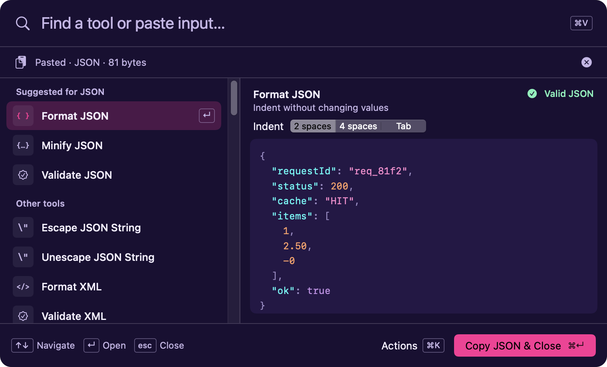

# Toolchord

> [!IMPORTANT]
> LLM disclosure: This codebase was written with substantial help from large language models: AI coding agents working from the [`AGENTS.md`](AGENTS.md) brief in this repo.

Developer tools a shortcut away. Toolchord is a native macOS palette for the small jobs between edits: format an API response, decode a token, convert a timestamp, or generate an ID. Press **⌥⇧Space** over any app, press **⌘V**, read the live preview, and press **⌘↵** to copy the result and go straight back to work.

**Latest release:** v<!-- version -->1.0<!-- /version --> · [Download](https://github.com/L-K-M/Toolchord/releases/latest)


## What it does

56 built-in commands in 18 tool families, all offline:

- **JSON** — format, minify, and validate without changing a single number or key order; escape and unescape string literals.
- **XML** — format structure while keeping mixed content and preserved whitespace intact; well-formedness and namespace checks.
- **Encoding** — Base64 and Base64URL, URL components, HTML entities, text ↔ hex.
- **Inspection** — URLs with every query parameter, JWT headers and claims with readable expiry, character and word counts.
- **Conversion** — Unix time ↔ RFC 3339, number bases at any size, hex/`rgb()`/`hsl()` colors, ten case styles and slugs.
- **Generation** — UUID v4 and v7, ULID, secure random strings, lorem ipsum, the current time.
- **Lines and hashes** — sort, deduplicate, and reverse lines; SHA-256, SHA-512, SHA-1, and MD5.
- **Plain text and Markdown** — strip hidden characters, non-breaking spaces, and smart quotes from copied text; turn HTML or Markdown into readable plain text; render Markdown to HTML.

Paste something and Toolchord suggests the tools that fit it. Every result shows exactly what ⌘↵ will copy, errors point to the line and column, and inspectors give each field its own Copy button.

## Make Custom Tool

Search for **Make Custom Tool** in the palette. Describe what you want, choose a provider and model, then run the generated JavaScript on a sample. Press **⌘↵** to run the sample and **⌘S** to add the tested tool to the palette. Select a saved tool in the sidebar to revise it. The Script tab lets you edit JavaScript directly. [JavaScript tool API and example](docs/javascript-tools.md)

Toolchord detects installed **Codex CLI** and **Claude Code** and uses the selected harness’s existing sign-in. Choose **List Models**, type a model ID, or keep the harness default. If **Ollama** is installed, start its server and choose one of its models. For an **OpenAI-compatible endpoint**, enter the API base URL and optionally save a key in macOS Keychain. Apple Intelligence remains available offline on eligible Macs running macOS 26 or later. The other providers and the editor support macOS 14 or later.

File ▸ Open Tool opens a working copy of a version-one JSON or `.toolchord` file. You can also open a `.toolchord` file from Finder or drop it on the editor. File ▸ Export Tool writes a portable copy. The library and exported files are independent. Toolchord recovers interrupted edits to a tool definition the next time you open the editor. Samples, generation prompts, and results stay out of the recovery file.

## Privacy

The palette and its JavaScript tools run locally in the App Sandbox without network access. Toolchord reads the clipboard only when you paste and keeps the input in memory while the palette is open. If you generate with a CLI or custom endpoint, a separate native service sends the tool description and, for a revision, the current definition to the provider you chose. Samples and palette input stay local. Each endpoint has its own Keychain credential. Results you copy go to the standard system clipboard, which macOS may share with your other devices through [Universal Clipboard](https://support.apple.com/en-us/102430). Generated random strings are the exception: they stay on this Mac and are marked as confidential, which asks clipboard history apps that follow the [nspasteboard.org](http://nspasteboard.org) convention not to keep or show them.

## Requirements

- macOS 14 Sonoma or later (Liquid Glass on macOS 26 and later)
- To build: Xcode 26 or later and [XcodeGen](https://github.com/yonaskolb/XcodeGen) (`brew install xcodegen`)

## Build and run

```bash
make run
```

This generates `Toolchord.xcodeproj` from `project.yml`, builds a release app into `build/DerivedData`, and opens it. To install it, use `make install`, which copies the app to `/Applications`. Local builds are ad-hoc signed; set your team in `project.yml` to sign for distribution.

To work in Xcode, run `make project` and open `Toolchord.xcodeproj`.

For the shared build and release entry points, install the current
[lkm-build and lkm-release engines](https://github.com/L-K-M/release-tool)
by running `./install.sh` in that repository, then use:

```bash
scripts/build.sh --install
scripts/release.sh 1.0.1          # bump project.yml + README and create a local tag
scripts/release.sh 1.0.2 --push   # also push the commit and tag to publish zip + DMG
```

The build script requires App Sandbox support from the engine. The release
script generates the Xcode project first; nothing is published without `--push`.

## Use

| Key | Action |
| --- | --- |
| ⌥⇧Space | Open Toolchord over any app (change it in Settings; ⌃⌘Space is one click away) |
| ⌘V | Attach the clipboard as input |
| ↑ ↓ | Choose a tool; the preview follows |
| ⌘↵ | Copy the result and close |
| ↵ | Open the tool with an editor |
| ⌘K | Actions: copy without closing, options, regenerate, and more |
| esc | Back, or close |

Settings (from the menu bar icon or ⌘, in the palette) have two tabs. General covers the shortcut, opening at login, the menu bar icon, JSON and XML indentation, and recent tools. Appearance covers themes.

## Themes



Settings ▸ Appearance shows a live preview of the palette and 20 presets besides the default look, from Memphis and Paper to Synthwave, Phosphor, and High Contrast. Pick one, then change any part of it: the appearance, accent, surface color and opacity, wells, text, code and syntax colors, status colors, corner roundness, and the code typeface. Interface text size and code size stay as you set them when you switch presets, and Reset to Default brings back Toolchord's own look.

Custom colors keep the palette Light or Dark, because one fixed color can't stay legible in both; the System appearance follows your Mac with the standard colors. Toolchord checks the colors it draws against WCAG contrast minimums, lists any that fall short, and can raise them for you. With Increase Contrast it raises every theme color further and outlines wells and the selection; with Reduce Transparency a translucent surface turns solid. Copy Theme and Paste Theme share a look as a short JSON text through the clipboard.

## Develop

```bash
make test
```

More than 550 tests cover every tool fixture, a robustness sweep that runs each command against awkward input, the session's stale-result and copy rules, the theme model and its contrast audit, and the Mac layer's logic.

```bash
make snapshots
```

This renders palette states to `build/snapshots` for design review, including one per theme preset and the Appearance tab. `make benchmark` times every command on 10 KiB and 1 MiB inputs.

| Directory | Contents |
| --- | --- |
| `Sources/ToolchordCore` | JavaScript tool catalog and runtime, input detection, and search ranking |
| `Sources/ToolchordSession` | The palette draft: selection, evaluation scheduling, and copy gating |
| `Sources/ToolchordTheme` | The theme model, presets, stored JSON format, and contrast audit (Foundation only) |
| `Sources/ToolchordMac` | Panel, global shortcut, pasteboard, SwiftUI views, Settings, and the snapshot renderer |
| `App`, `project.yml` | The app target: Info.plist keys, sandbox entitlements, and the Icon Composer icon |

To add a bundled tool, declare it in `Sources/ToolchordCore/Scripts/catalog.json`, implement its JavaScript preview, and add fixtures for its behavior. See the [tool API](docs/javascript-tools.md).

## Documentation

- [Product plan](docs/product-plan.md): scope, panel layout, keyboard behavior, and acceptance checks
- [Shortcut UX](docs/shortcut-ux.md): search, paste, keys, and copy targets
- [Implementation contracts](docs/implementation-contracts.md): tool contracts, fixtures, and native decisions
- [Research](docs/research.md): competitors, demand, the catalog decision, and macOS constraints
- [Design review](docs/design-review.md): how the proposed mockups shaped the panel

**Status:** first release implemented. Toolchord is a working name.

## License

Toolchord's own code is released into the public domain under [The Unlicense](LICENSE).
